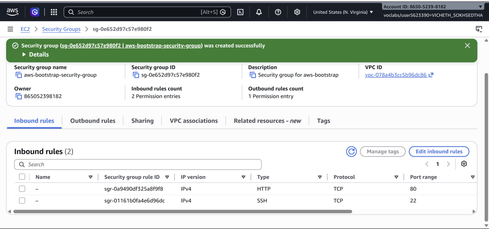
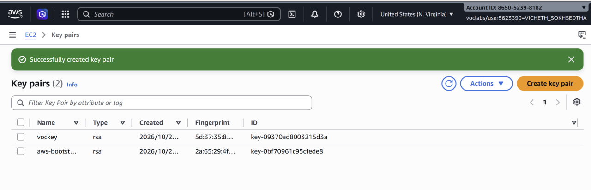
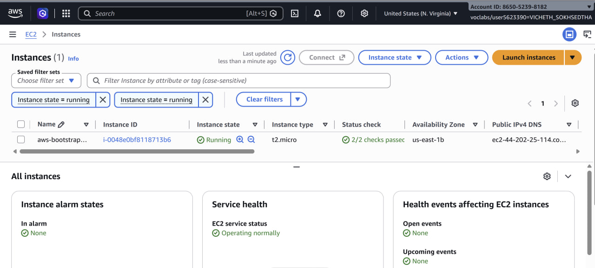
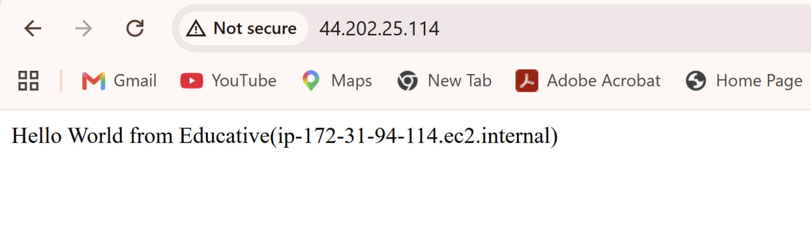
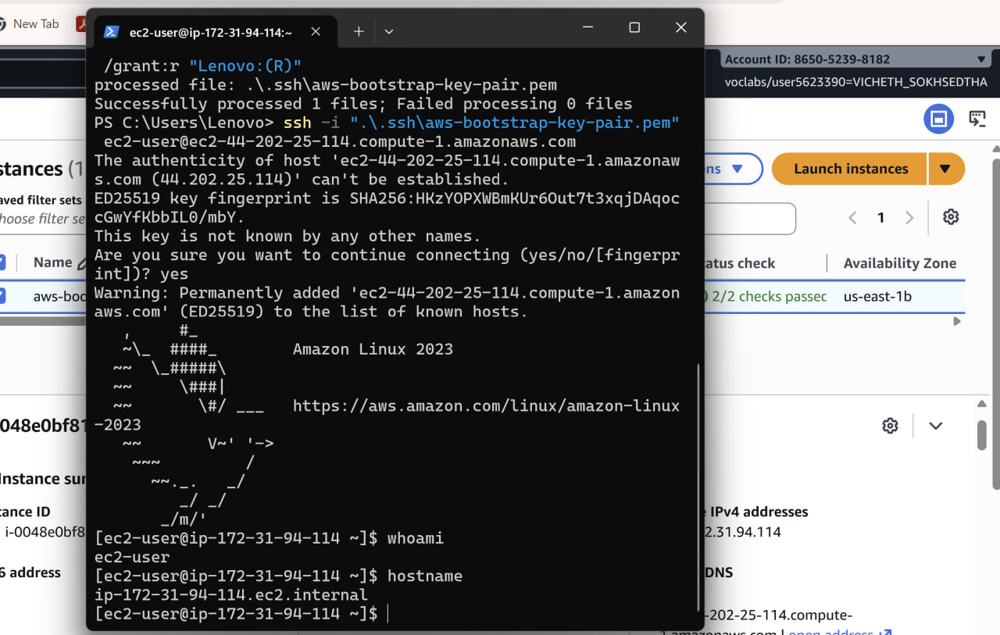
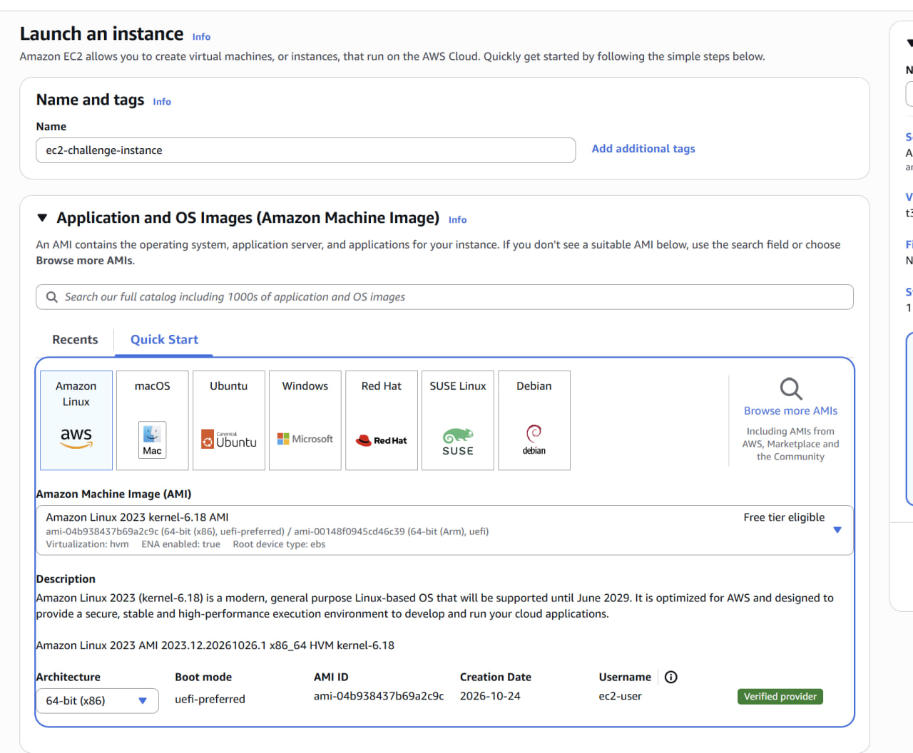
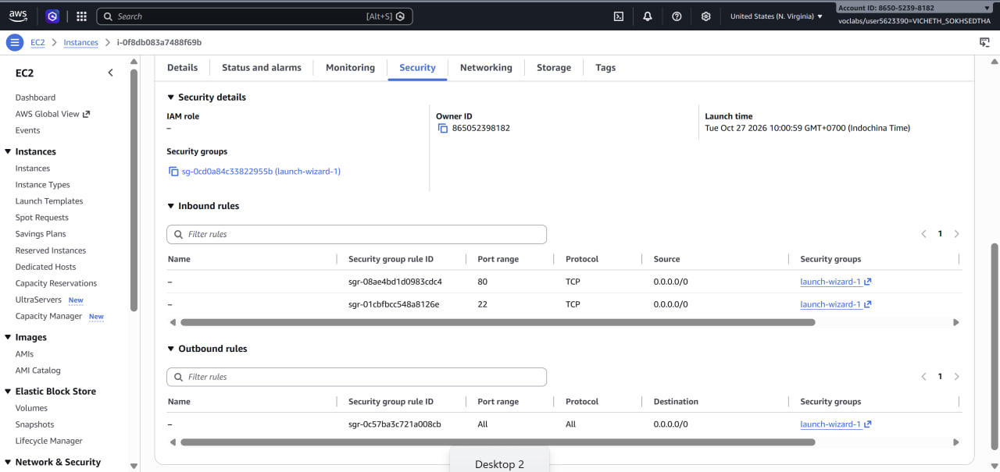
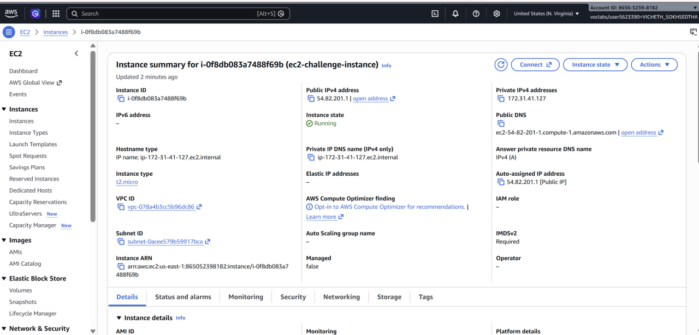
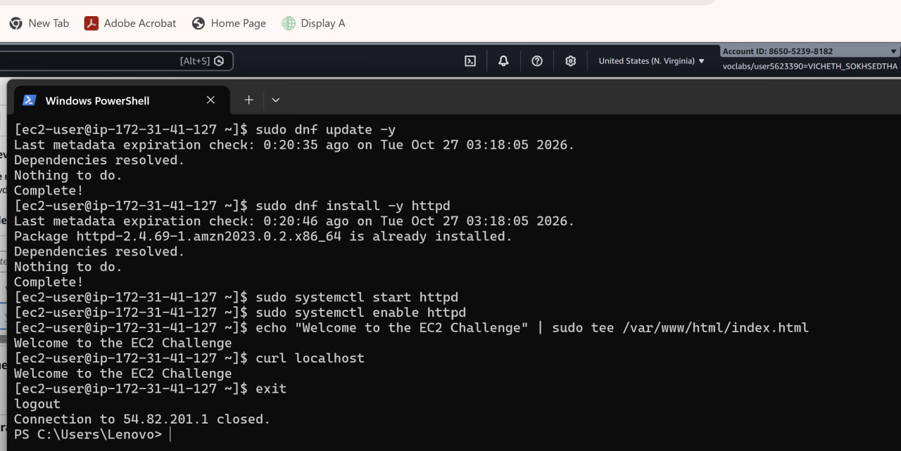
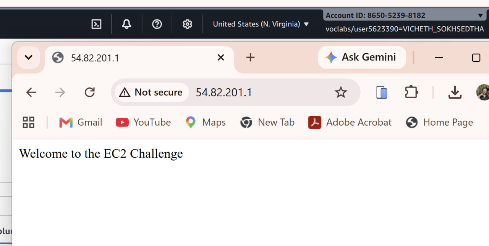

# Cloud Lab 1 Submission — Amazon EC2

- **Student name:** Vicheth Sokhsedtha
- **Student ID:** e20221549
- **Learner Lab user name:** voclabs/user5623390=VICHETH_SOKHSEDTHA
- **Date completed:** October 27, 2026

---

## Part 1.1 — An Amazon EC2 Walkthrough

### Security group



### Key pair



### Instance details



### Browser test



### SSH connection



Did you connect with your own SSH client or with EC2 Instance Connect?

I connected with my own SSH client: the OpenSSH client in Windows PowerShell. I moved the key to `C:\Users\Lenovo\.ssh\`, restricted its permissions with `icacls`, and connected with:

```powershell
ssh -i ".\.ssh\aws-bootstrap-key-pair.pem" ec2-user@ec2-44-202-25-114.compute-1.amazonaws.com
```

`whoami` returned `ec2-user` and `hostname` returned `ip-172-31-94-114.ec2.internal`.

---

## Part 1.2 — EC2 Web Solution (Challenge)

### Launch configuration



### Security group



### Running instance



### Commands on the instance



Paste the commands you ran to install the web server and create `index.html`:

```bash
sudo dnf update -y
sudo dnf install -y httpd
sudo systemctl start httpd
sudo systemctl enable httpd
echo "Welcome to the EC2 Challenge" | sudo tee /var/www/html/index.html
curl localhost
```

### Browser test



---

## Questions

**1. Your security group has an SSH rule and an HTTP rule. What does each one let you do? What would stop working if you deleted the HTTP rule?**

The **SSH rule** (TCP port 22) allows remote login to the instance, with my own SSH client or with EC2 Instance Connect, so I can run commands on it. The **HTTP rule** (TCP port 80) allows browsers on the internet to request web pages from the Apache server.

If I deleted the HTTP rule, the security group would block all incoming traffic on port 80, so opening `http://<public-IP>` in a browser would time out. Apache would still be running, and `curl localhost` from inside the instance would still work, because that traffic does not pass through the security group. SSH would also keep working.

**2. In Part 1.1 you never logged in to install the web server. What installed it, and when did it run?**

The **user data script** that I pasted in *Advanced details* installed it. EC2 runs the user data script automatically as root (through cloud-init) **once, during the first boot** of the instance. The script updated the packages, installed `httpd`, started and enabled the service, and wrote `index.html`. This is called bootstrapping, and it is why I had to wait a minute or two after the instance was *Running* before the page appeared.

**3. Why does the web page open with `http://` but not with `https://`?**

`https://` uses TLS on **port 443**. Our security group only allows ports 22 and 80, so traffic on port 443 is blocked. In addition, Apache was installed without HTTPS support: there is no TLS module (`mod_ssl`) and no SSL certificate, so nothing on the instance listens on port 443. Plain `http://` uses port 80, which is both allowed by the security group and served by Apache.

**4. Part 1.2 asked for a 10 GiB root volume. Where in the launch settings did you set it, and how can you check the size on the running instance?**

I set it in the **Configure storage** section of the *Launch an instance* page, by changing the root volume from the default **8 GiB to 10 GiB** (gp3).

To check it, I opened the instance in the EC2 console and selected the **Storage** tab: the root device `/dev/xvda` (volume `vol-03513d26ba696449d`) showed **Volume size: 10 GiB**. On the instance itself, the size can also be checked with:

```bash
lsblk        # shows the xvda disk as 10G
df -h /      # shows the size of the root file system
```

## Problems and how I solved them (optional)

| Problem | Solution |
|---|---|
| SSH on Windows refuses a private key that other users can read. | I removed inherited permissions with `icacls ... /inheritance:r` and gave read access only to my user with `icacls ... /grant:r "Lenovo:(R)"`. |
| My SSH session disconnected with `client_loop: send disconnect: Connection reset`. | I reconnected with `ssh -o ServerAliveInterval=30 ...`, which sends keep-alive messages so the connection stays open. |
| I first ran `echo` and `sudo tee` as two separate commands, which emptied `index.html`. | I ran them as one command with a pipe: `echo "Welcome to the EC2 Challenge" \| sudo tee /var/www/html/index.html`, then checked with `curl localhost`. |
| The Learner Lab session ended between my two work sessions. | I clicked **Start Lab** again before continuing. |

## AI note (optional)

One suggestion an AI tool gave you and how you checked it.

I used Claude to guide me through the lab. It suggested creating `index.html` with `echo "..." | sudo tee /var/www/html/index.html` instead of `sudo echo "..." > /var/www/html/index.html`, because the `>` redirection runs as my normal user and gets "Permission denied". I checked the result with `curl localhost` on the instance, which printed *Welcome to the EC2 Challenge*, and then by opening `http://54.82.201.1` in my browser.

## Clean up

- [x] Part 1.1: instance terminated, key pair and security group deleted.
- [x] Part 1.2: instance terminated, security group (and key pair, if any) deleted.