# Cloud Lab 2 — Application Load Balancer and Auto Scaling

## Description

This lab demonstrates how an **Application Load Balancer (ALB)** distributes HTTP requests across EC2 instances managed by an **Auto Scaling group (ASG)**. A target group tracks the instances and checks whether their web applications are healthy. If an instance fails its health checks, the ASG replaces it.

The setup uses the default VPC in **US East (N. Virginia) (`us-east-1`)**:

- `LoadBalancerSecurityGroup` allows inbound HTTP traffic to the load balancer.
- `LaunchTemplateSecurityGroup` allows inbound HTTP and SSH traffic to the EC2 instances.
- `LoadBalancerTargetGroup` routes HTTP traffic to the instances and performs health checks.
- `MyLoadBalancer` is an internet-facing ALB listening on HTTP port 80.
- `AutoScalingLaunchTemplate` launches Amazon Linux 2023 `t2.micro` instances and starts an Apache (`httpd`) web server.
- `MyAutoScalingGroup` keeps two instances running, with a maximum capacity of three, and is attached to the target group.

After both targets become healthy, opening the load balancer's DNS name displays a message containing the hostname of the instance that handled the request. Refreshing the page demonstrates traffic being served by different instances. Stopping `httpd` on one instance causes its health check to fail; the ASG then launches a replacement instance.

## Screenshots

### Security groups and target group

1. **Load balancer security group** — HTTP inbound rule for `LoadBalancerSecurityGroup`.  
   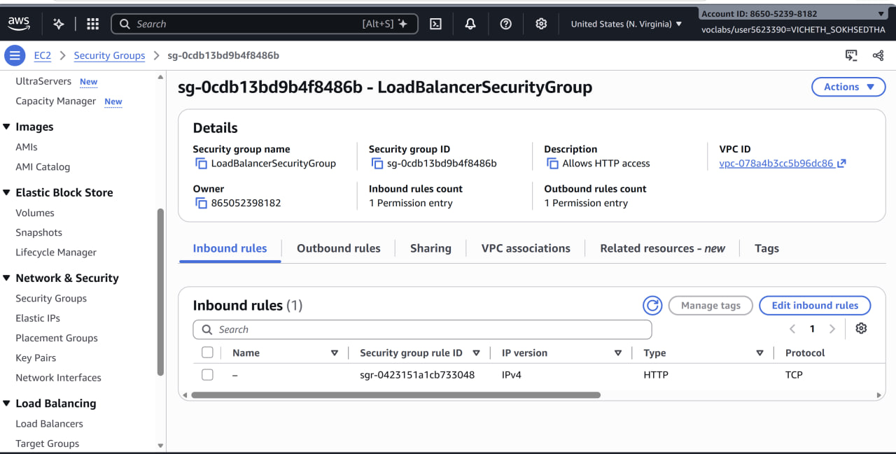
2. **Launch template security group** — HTTP and SSH inbound rules for `LaunchTemplateSecurityGroup`.  
   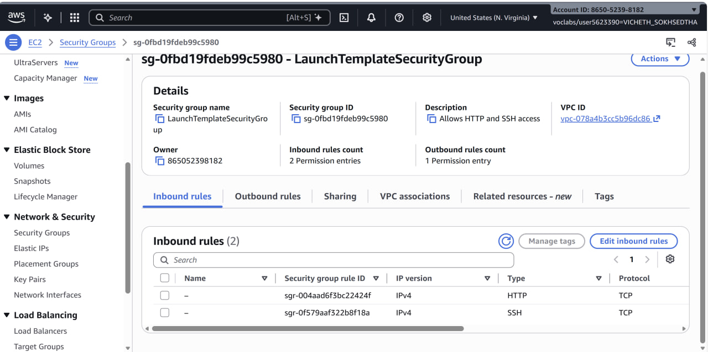
3. **Target group** — `LoadBalancerTargetGroup` configuration.  
   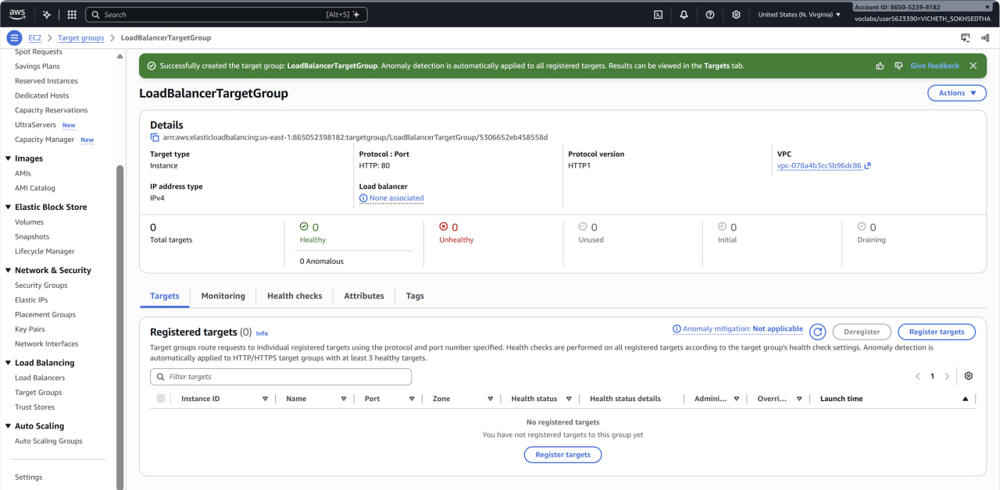
4. **Health checks** — target group health check settings.  
   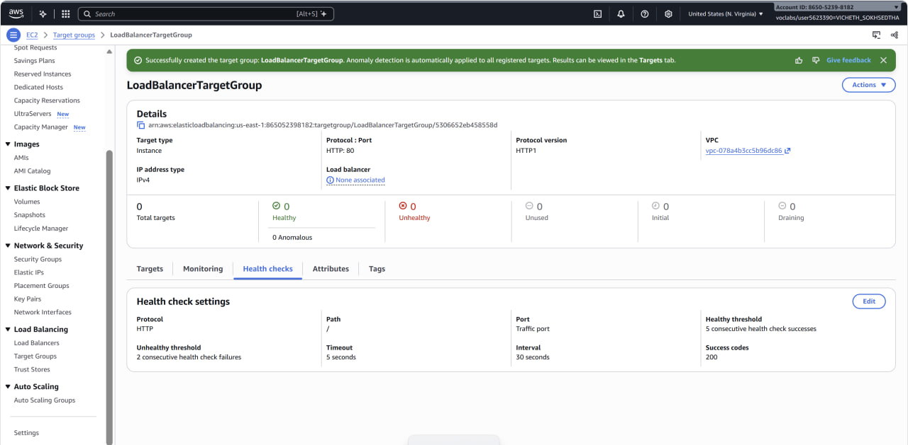

### Load balancer and Auto Scaling group

5. **Load balancer list** — `MyLoadBalancer` in the AWS console.  
   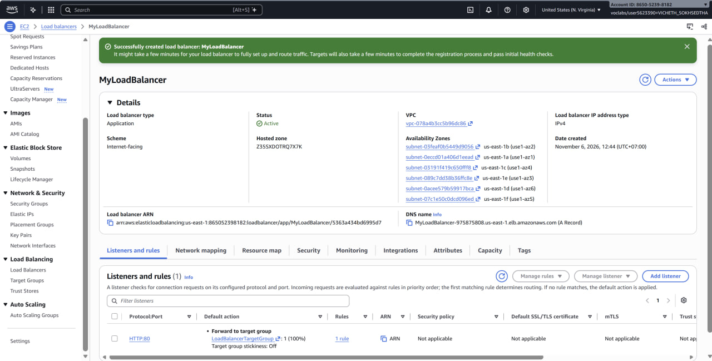
6. **Load balancer details** — internet-facing scheme and security group.  
   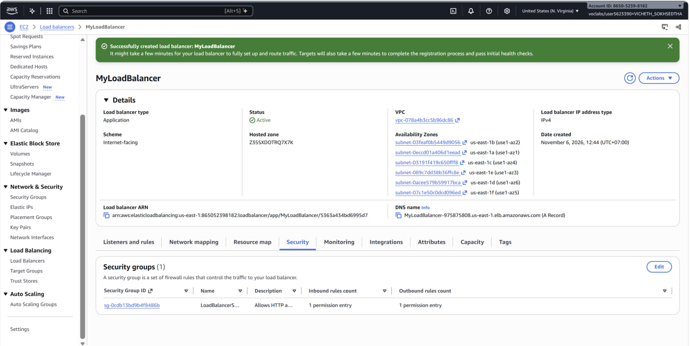
7. **Launch template** — instance image, type, security group, and user data.  
   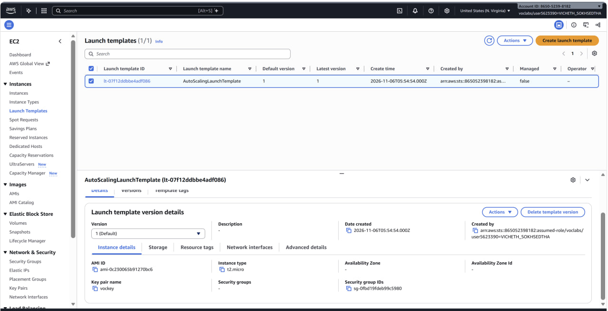
8. **Auto Scaling group list** — `MyAutoScalingGroup` in the AWS console.  
   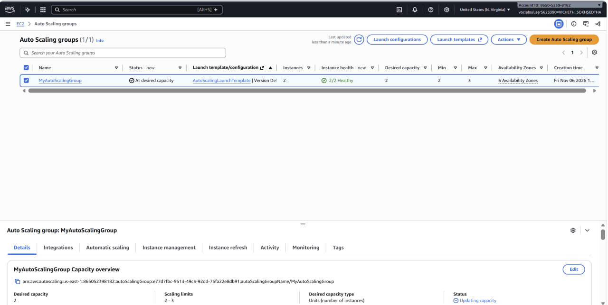
9. **Auto Scaling group details** — capacity settings and attached target group.  
   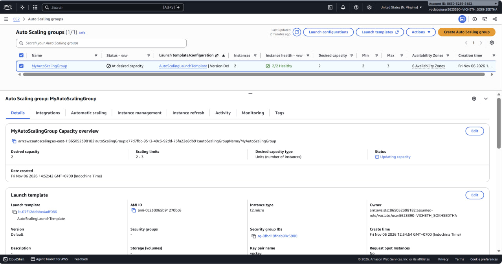

### Testing load balancing and recovery

10. **First browser request** — response from an instance through the load balancer.  
    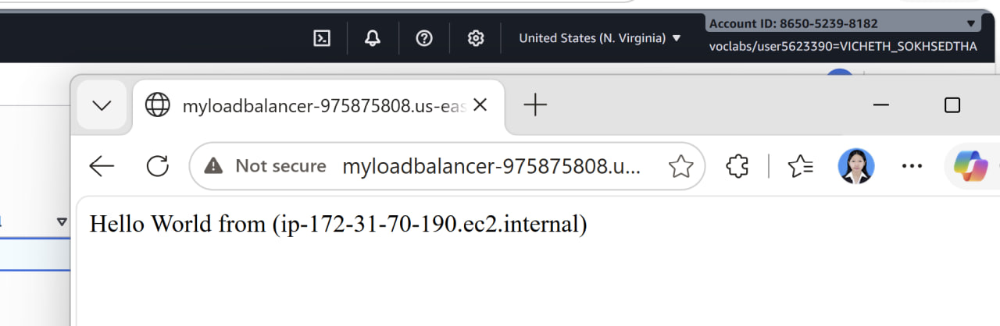
11. **Second browser request** — response showing a different instance hostname.  
    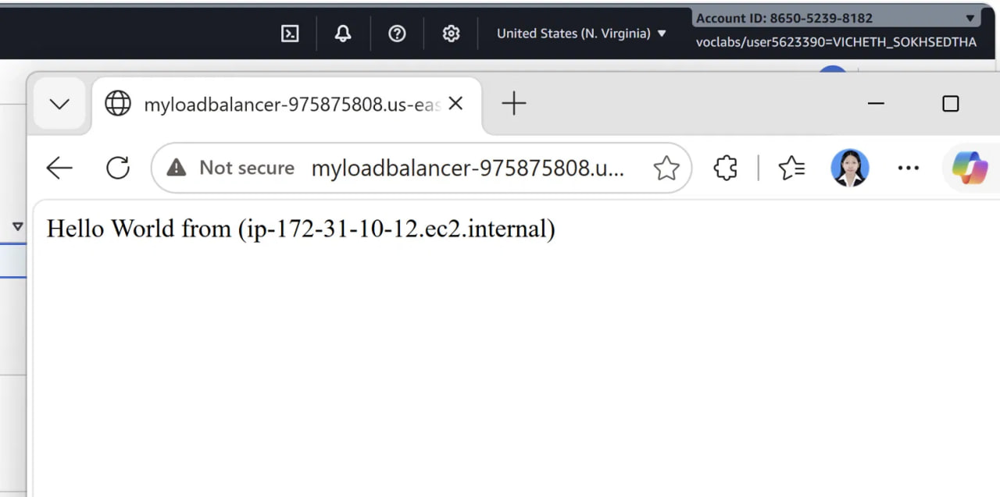
12. **Application failure** — terminal after stopping the Apache web server.  
    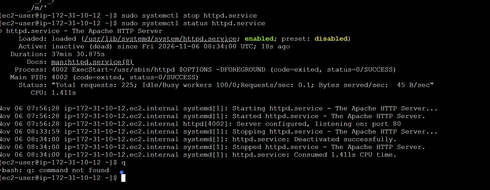
13. **Unhealthy target** — target group showing the failed instance as unhealthy or draining.  
    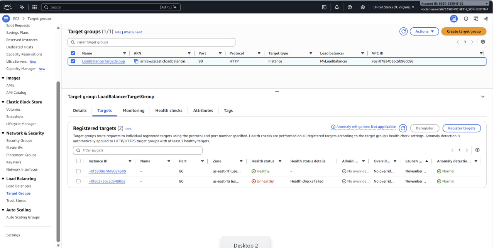
14. **Replacement target** — target group showing the replacement instance as healthy.  
    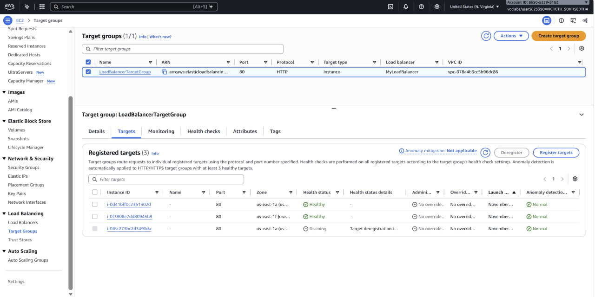