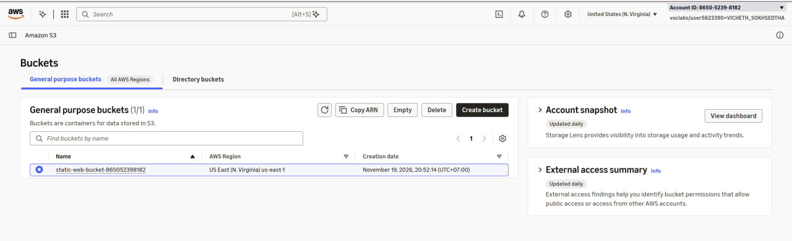
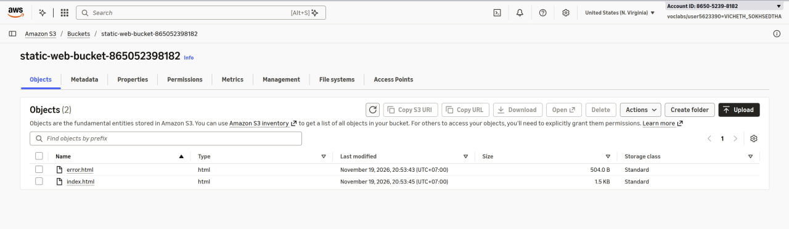
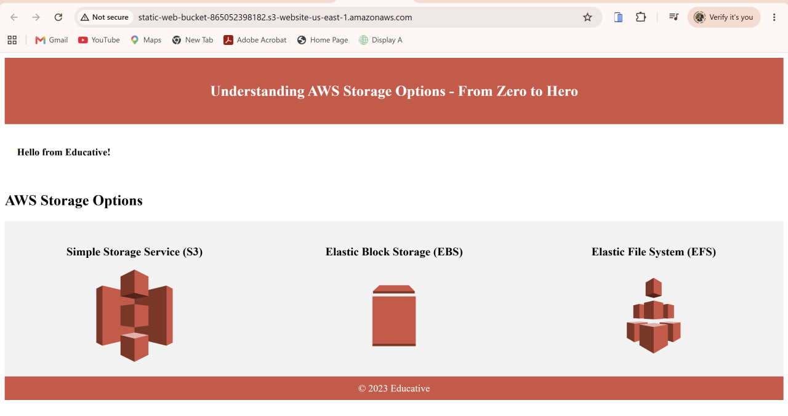
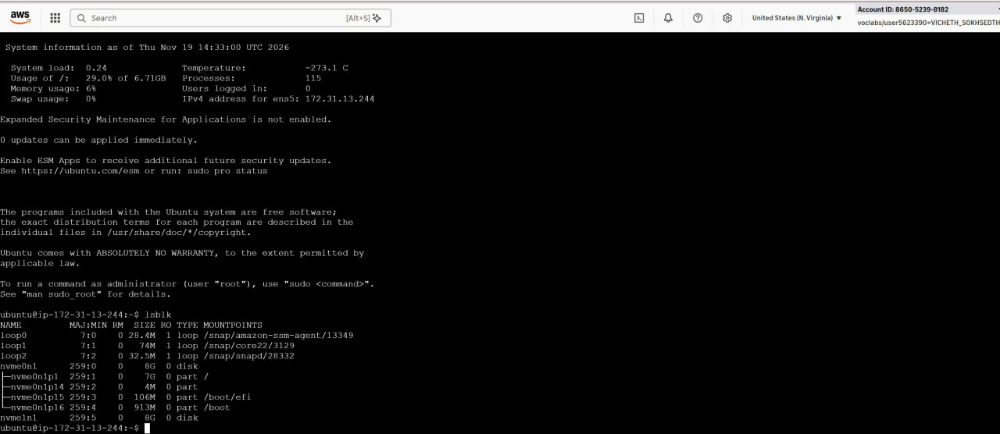
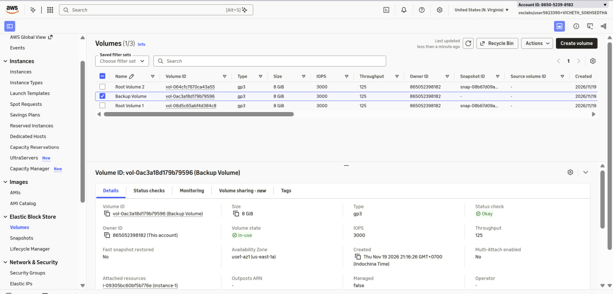
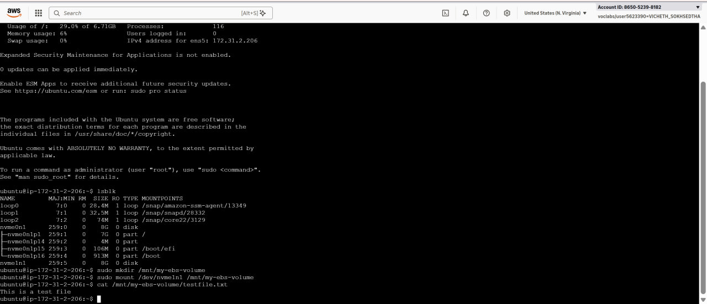
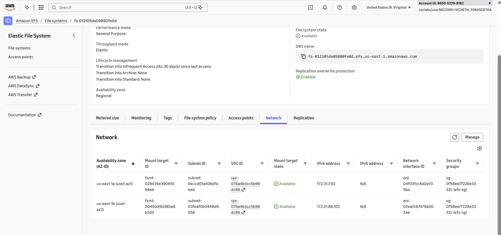
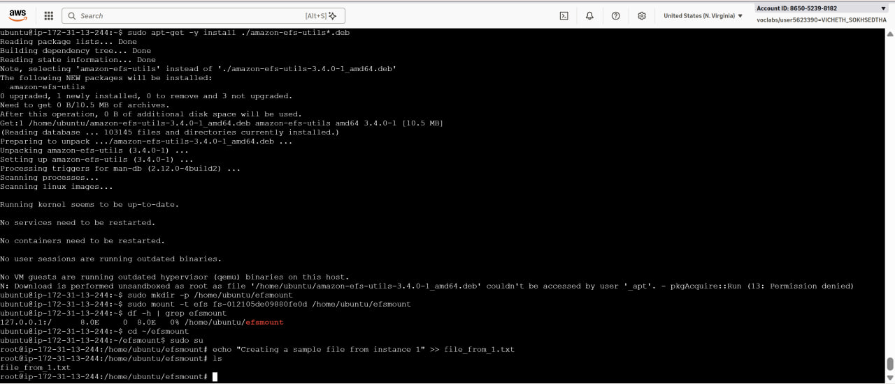
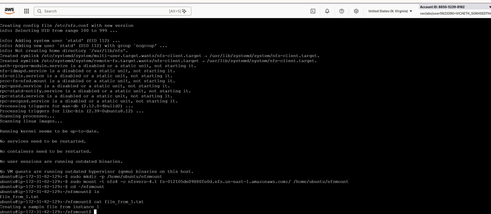

# Lab 3 — Understanding AWS Storage Options

| Item | Details |
|---|---|
| Student | VICHETH SOKHSEDTHA |
| Student ID | e20221549 |
| Environment | AWS Academy Learner Lab |
| Region | US East (N. Virginia) `us-east-1` |
| Services | Amazon S3 · Amazon EBS · Amazon EFS · Amazon EC2 · Amazon VPC |

## Overview

In this lab I worked with the three main AWS storage services:

- **Amazon S3** (object storage): I created a bucket, uploaded two HTML files and hosted a static website with a bucket policy.
- **Amazon EBS** (block storage): I created a volume, attached it to an EC2 instance, formatted and mounted it, wrote a file, then moved the volume to a second instance and read the same file.
- **Amazon EFS** (file storage): I created a shared NFS file system with mount targets in two Availability Zones, mounted it on two instances, wrote a file from one and read it from the other.

---

## Part 2.1 — Amazon S3

### Task 1 — Create a bucket and upload files

I created the bucket `static-web-bucket-865052398182` in `us-east-1` and turned off **Block all public access** so that a bucket policy could make it public later. Then I uploaded `index.html` and `error.html`.





### Task 2 — Static website hosting

I enabled **Static website hosting** with `index.html` as the index document and `error.html` as the error document. The endpoint first returned **403 Forbidden**, because turning off Block Public Access is not enough on its own. I then added this bucket policy, which lets everyone (`"Principal": "*"`) read (`s3:GetObject`) every object (`/*`) in the bucket:

```json
{
    "Version": "2012-10-17",
    "Statement": [
        {
            "Sid": "Statement1",
            "Principal": "*",
            "Effect": "Allow",
            "Action": ["s3:GetObject"],
            "Resource": "arn:aws:s3:::static-web-bucket-865052398182/*"
        }
    ]
}
```

After that, the website endpoint showed the `index.html` page.



---

## Part 2.2 — Amazon EBS

### Task 3 — Launch two EC2 instances

I created the security group `ec2instances-sg` (inbound SSH from `0.0.0.0/0`) and launched `instance-1` and `instance-2` (Ubuntu Server 24.04, `t3.medium`, 8 GiB gp3) in subnet **us-east-1a**.

### Task 4 — Create an EBS volume

I renamed the root volumes `Root Volume 1` and `Root Volume 2`, then created an 8 GiB **gp3** volume named `Backup Volume` in **us-east-1a**. An EBS volume can only be attached to instances in the same Availability Zone.

### Task 5 — Attach, format and mount the volume

I attached `Backup Volume` to `instance-1` as `/dev/sdf`. On `t3` instances, EBS volumes appear as NVMe devices, so `lsblk` showed the volume as **`nvme1n1`** (8 GB, no partitions, no mount point).



```bash
sudo mkfs -t ext4 /dev/nvme1n1
sudo mkdir /mnt/my-ebs-volume
sudo mount /dev/nvme1n1 /mnt/my-ebs-volume
sudo su
cd /mnt/my-ebs-volume
echo "This is a test file" > testfile.txt
```



### Task 6 — Move the volume to another instance

I unmounted the volume on `instance-1` (`sudo umount -l /mnt/my-ebs-volume`), detached it in the console, attached it to `instance-2` as `/dev/sdf`, and mounted it **without** running `mkfs` again (`mkfs` would have erased the data):

```bash
sudo mkdir /mnt/my-ebs-volume
sudo mount /dev/nvme1n1 /mnt/my-ebs-volume
cat /mnt/my-ebs-volume/testfile.txt
```

The file was still there. This shows that data on an additional EBS volume persists independently of the instance.



---

## Part 2.3 — Amazon EFS

### Task 7 — Create an EFS file system

I created the security group `efs-sg` (inbound **NFS**, port 2049) and the file system `clab-efs` (`fs-012105de09880fe0d`) with these settings: Regional, automatic backups off, Transition into Archive set to None, encrypted, Enhanced / Elastic throughput. I kept only two mount targets, in **us-east-1a** and **us-east-1b**, both using `efs-sg`.



### Task 8 — Launch a third instance

I launched `instance-3` in **us-east-1b**, so that each instance connects through the mount target in its own Availability Zone.

### Task 9 — Mount the file system

On `instance-1` I built and installed `amazon-efs-utils` v3.4.0 from source, then mounted the file system:

```bash
sudo mkdir -p /home/ubuntu/efsmount
sudo mount -t efs fs-012105de09880fe0d /home/ubuntu/efsmount
```

On `instance-3` I mounted the same file system with the standard NFS client:

```bash
sudo apt-get -y install nfs-common
sudo mkdir -p /home/ubuntu/efsmount
sudo mount -t nfs4 -o nfsvers=4.1 fs-012105de09880fe0d.efs.us-east-1.amazonaws.com:/ /home/ubuntu/efsmount
```

### Task 10 — Share a file between instances

On `instance-1`:

```bash
cd ~/efsmount
sudo su
echo "Creating a sample file from instance 1" >> file_from_1.txt
```



On `instance-3`, `ls` showed `file_from_1.txt`, and `cat` printed its contents. Both instances, in different Availability Zones, share the same file system.



---

## Problems and Solutions

| Problem | Cause | Solution |
|---|---|---|
| EC2 Instance Connect: *"Error establishing SSH connection"* | The default VPC had no internet gateway. The route `0.0.0.0/0` pointed to a deleted gateway (**Blackhole**). | Created the internet gateway `lab-igw`, attached it to the default VPC, and changed the `0.0.0.0/0` route to target `lab-igw`. The route became **Active**. |
| `mkfs` / `mount`: *"/dev/xvdf does not exist"* | `t3` instances use NVMe, so the volume appears as `/dev/nvme1n1`, not `/dev/xvdf`. | Used the device name shown by `lsblk`: `/dev/nvme1n1`. |
| Installing `amazon-efs-utils`: *"No space left on device"* | The Rust and Go toolchains and the build files filled the 8 GiB root volume. | Copied the built `.deb` to the home folder, deleted `~/efs-utils`, `~/.rustup`, `~/.cargo`, `~/go` and `~/.cache`, ran `apt-get clean`, then installed the package. On `instance-3` I used the standard NFS client (`nfs-common`) to avoid the long build. |

---

## Comparison of S3, EBS and EFS

| | Amazon S3 | Amazon EBS | Amazon EFS |
|---|---|---|---|
| Storage type | Object | Block | File (NFS) |
| Access | Over HTTP(S) from anywhere, via API or URL | Attached to one EC2 instance at a time, like a hard disk | Mounted by many instances at the same time |
| Scope | Regional, global bucket names | One Availability Zone | Regional (several AZs) |
| Scaling | Unlimited, objects up to 5 TB | Fixed size chosen at creation | Grows and shrinks automatically, up to petabytes |
| Pricing | Storage used + requests | Provisioned size | Storage used |
| Typical use | Static websites, backups, data lakes, logs | OS and database disks for one instance | Shared files for several servers, containers or Lambda functions |

**How to choose:**
- Use **S3** for files that should be reached over the web or kept as backups.
- Use **EBS** for fast disk storage for a single instance, such as a database.
- Use **EFS** when several instances need to read and write the same files at the same time.

---

## Clean Up

After taking all screenshots, I terminated `instance-1`, `instance-2` and `instance-3`, deleted the EFS file system `clab-efs`, the volume `Backup Volume`, the security groups `efs-sg` and `ec2instances-sg`, and emptied and deleted the S3 bucket. I kept the internet gateway `lab-igw`, because the default VPC needs it for later labs.