# Cloud Lab 4 — VPC with Public and Private Subnets

## Description

This lab demonstrates how to build an isolated Amazon Virtual Private Cloud (VPC) and control internet access with subnet routing. The VPC, `lab4-vpc`, uses IPv4 CIDR `10.0.0.0/24` in **US East (N. Virginia) (`us-east-1`)**.

The network is divided into two subnets:

- `lab4-public-subnet` (`10.0.0.0/25`) uses a route to `lab4-internet-gateway` for internet access. The `lab4-ec2-01` instance is assigned a public IP address.
- `lab4-private-subnet` (`10.0.0.128/25`) uses `lab4-custom-route-table` to route internet-bound traffic through `lab4-nat-gateway`, which is located in the public subnet. The `lab4-ec2-02` instance has no public IP address.

Both instances use the `LabInstanceProfile` IAM instance profile so AWS Systems Manager can run commands without requiring inbound SSH access. The lab tests internet connectivity by running `sudo yum update -y` on each instance through Systems Manager Run Command. The public instance reaches the internet through the internet gateway, while the private instance reaches it through the NAT gateway.

## Screenshots

### VPC and public subnet

1. **VPC** — `lab4-vpc` with IPv4 CIDR `10.0.0.0/24`.  
   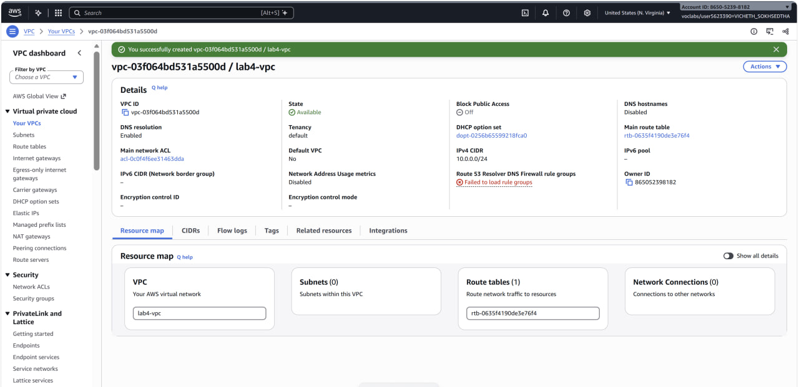
2. **Internet gateway** — `lab4-internet-gateway` attached to `lab4-vpc`.  
   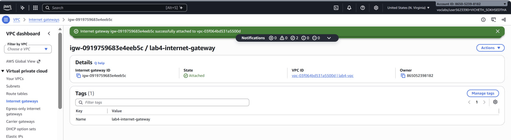
3. **Public subnet** — `lab4-public-subnet` with CIDR `10.0.0.0/25`.  
   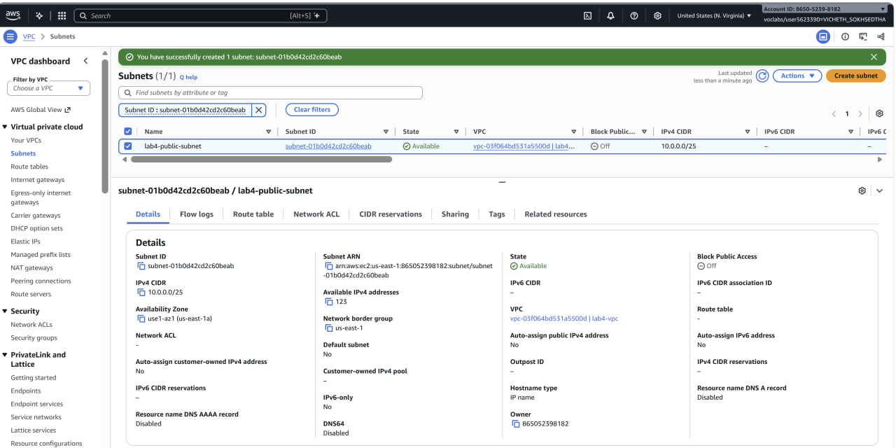
4. **Public route table** — default route `0.0.0.0/0` points to the internet gateway.  
   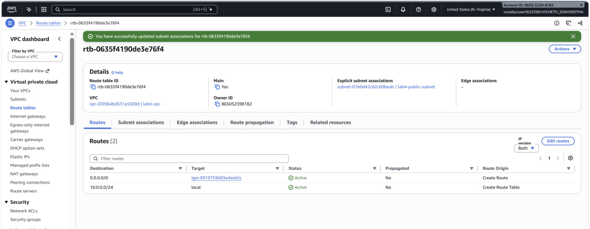
5. **Public EC2 instance** — `lab4-ec2-01` running in the public subnet with a public IP address.  
   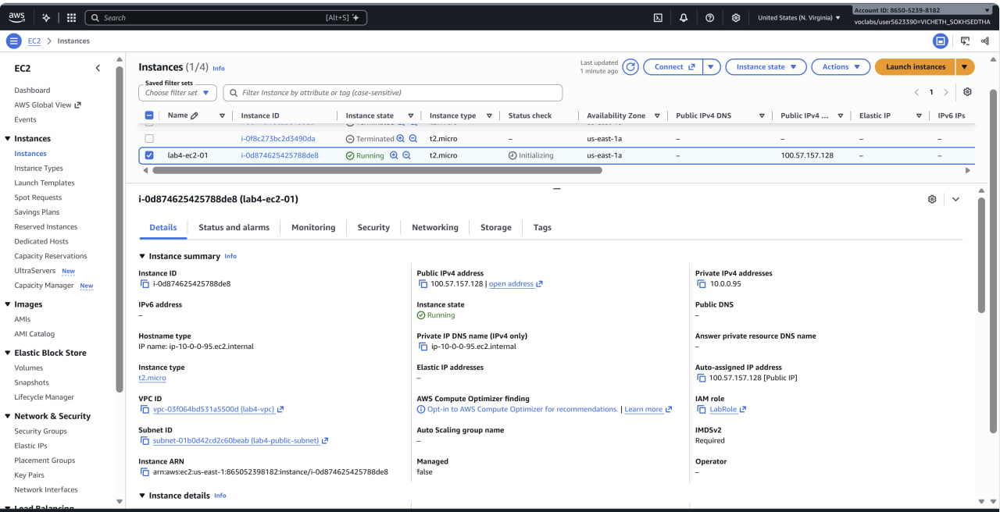
6. **Public connectivity test** — Systems Manager Run Command succeeds on `lab4-ec2-01`.  
   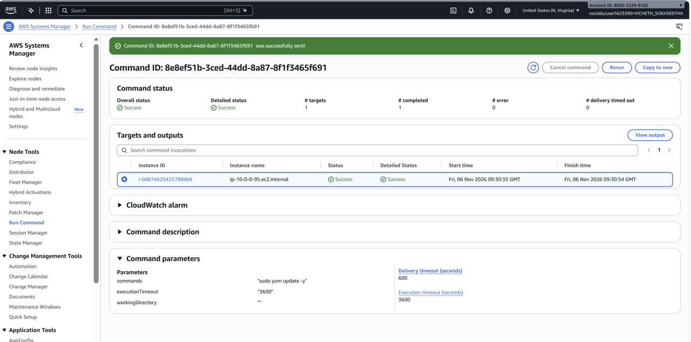

### Private subnet and NAT gateway

7. **Private subnet** — `lab4-private-subnet` with CIDR `10.0.0.128/25`.  
   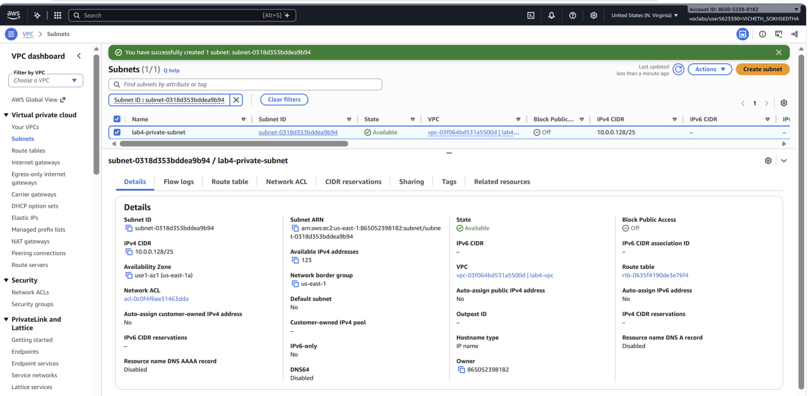
8. **NAT gateway** — `lab4-nat-gateway` in the public subnet with an Elastic IP address.  
   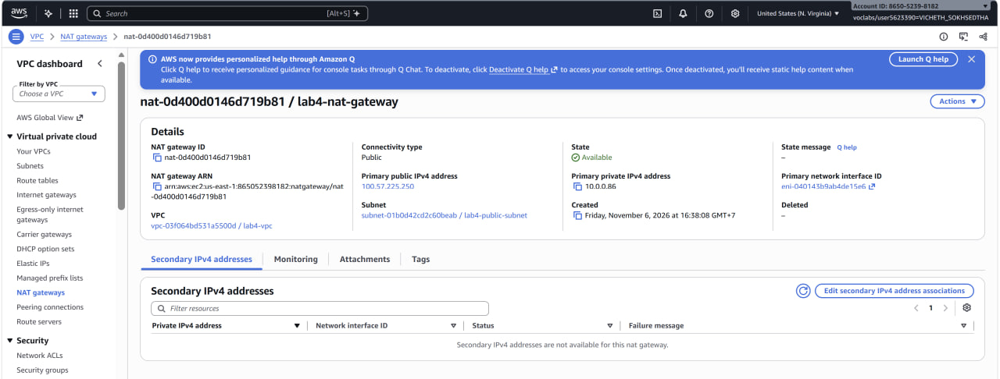
9. **Private route table** — `lab4-custom-route-table` routes `0.0.0.0/0` through the NAT gateway.  
   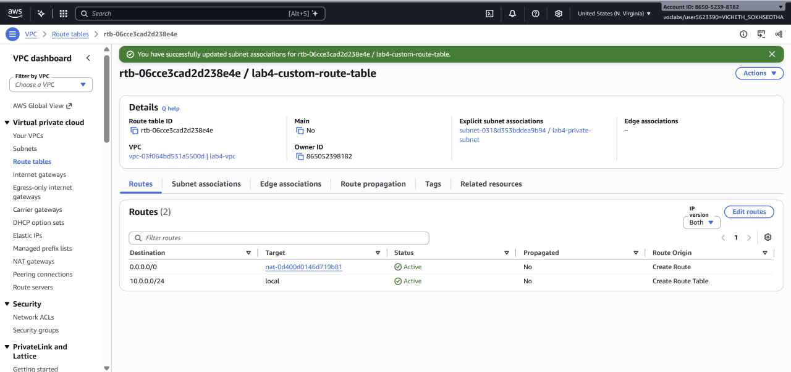
10. **Private EC2 instance** — `lab4-ec2-02` running in the private subnet without a public IP address.  
    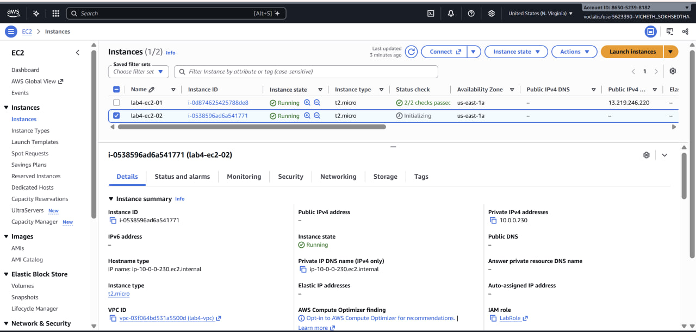
11. **Private connectivity test** — Systems Manager Run Command succeeds on `lab4-ec2-02`, demonstrating outbound internet access through the NAT gateway.  
    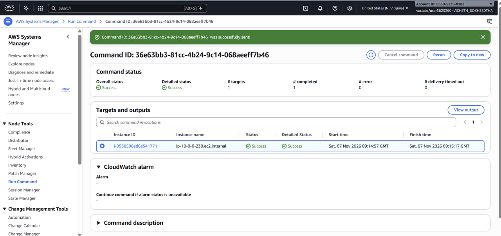

## Conclusion

The lab shows that a subnet's route table determines its internet access. The public subnet routes directly to the internet gateway, while the private subnet routes outbound internet traffic through a NAT gateway and does not assign a public IP to its instance. Systems Manager Run Command provides a way to test both instances without opening inbound SSH access.